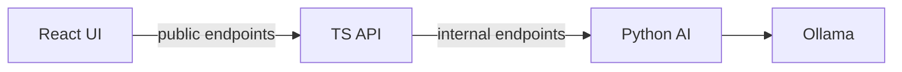
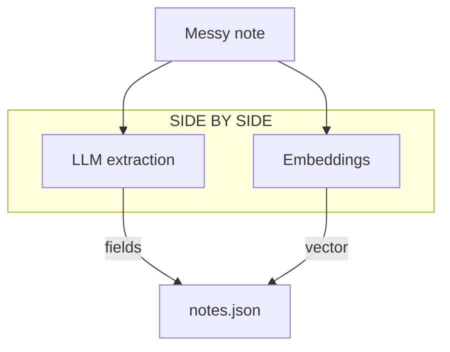
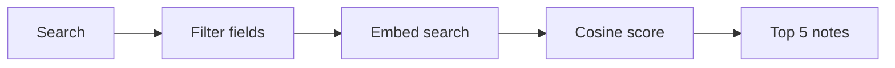

# Injury Semantic Search

Search my injury notes by meaning, not just keywords.

## Architecture



- **React UI** (TypeScript): the UI, localhost:5173
- **TS API** (TypeScript): login, notes, database, validated with Zod, localhost:3000
- **Python AI** (Python): extract, embed, search, validated with Pydantic, localhost:8000. **This repo.**
- **Ollama**: runs the models locally, localhost:11434

Each box is one service (one running program). They talk to each other over HTTP.

## How it works

Every RAG app has two flows: **indexing** (saving data) and **querying** (searching it).

### Indexing: when you save a note



The same note goes to **both** models, side by side:

- **LLM extraction** (structured outputs): `"Twisted my knee running, pain 6"` becomes `{ body_part: "knee", severity: 6, cause: "running" }`, validated with Pydantic. Used for filters, display and charts.
- **Embeddings**: the note text becomes a vector `[0.12, -0.48, 0.91, ...]`. Used for search by meaning.
- Both are saved together as one record in `data/notes.json`.

### Querying: when you search



- **Search** plus optional filters, for example `"pain after running"` with `body_part = knee`.
- **Filter fields** keeps only notes whose extracted fields match.
- **Embed search** turns the search into a vector (not saved).
- **Cosine score** compares it with each remaining note's vector.
- **Top 5 notes** are shown with their fields, highest score first.

## Learn more

- [Structured extraction](docs/structured-extraction.md): the LLM, how `messages` and roles work, and how a messy note becomes validated fields.
- [Embedding model](docs/embedding-model.md): what vectors are, the rules for using them, how notes are embedded and saved, and cosine similarity.

## Status

- [x] Milestone 1: Project skeleton (Python)
- [x] Milestone 2: Structured extraction (Python)
- [x] Milestone 3: Embed and persist
- [x] Milestone 4: Cosine similarity with tests
- [x] Milestone 5: search function (hybrid)
- [ ] Milestone 6: FastAPI endpoints
- [ ] Milestone 7: threshold experiment
- [ ] Milestone 8: React search UI

## Tech stack

| Tool         | Why                                         |
| ------------ | ------------------------------------------- |
| Python 3.12+ | The AI service                              |
| uv           | Virtual environment and packages (like npm) |
| Pydantic     | Validates the LLM's JSON output (like Zod)  |
| pytest       | Tests                                       |
| mypy         | Checks type hints (like tsc)                |
| Ollama       | Runs the models locally, free               |
| FastAPI      | HTTP endpoints for the TypeScript API       |

Models: `qwen2.5:3b` for extraction, `nomic-embed-text` for embeddings (both chosen by benchmark).

## Extraction Model choice

Each model extracted 5 fields from the same 10 labelled test notes (`eval/notes.json`), and `app/extraction/benchmark.py` compared its answers to the expected ones.

| Model          | Correct | Failed | Speed         |
| -------------- | ------- | ------ | ------------- |
| llama3.2       | 78%     | 0      | 1.2s/note     |
| **qwen2.5:3b** | **86%** | **0**  | **1.2s/note** |
| qwen2.5:7b     | 88%     | 0      | 2.4s/note     |

Chose **qwen2.5:3b**: only 1 field fewer than the 7B model (43 vs 44 out of 50), twice as fast, and smaller.

To run the benchmark yourself, pull all 3 models, then run it:

```bash
ollama pull llama3.2
ollama pull qwen2.5:3b
ollama pull qwen2.5:7b
uv run --env-file .env python -m app.extraction.benchmark
```

## Embedding model choice

12 test questions (`eval/queries.json`) were searched against the 10 test notes with each model and each text option, using `app/embedding/benchmark.py`. Top-1: the right note came first. Top-3: it was in the first 3.

| Model                | Text          | Top-1     | Top-3     |
| -------------------- | ------------- | --------- | --------- |
| **nomic-embed-text** | **raw**       | **11/12** | **12/12** |
| nomic-embed-text     | both          | 12/12     | 12/12     |
| mxbai-embed-large    | all 3         | 12/12     | 12/12     |
| all-minilm           | raw           | 11/12     | 12/12     |
| all-minilm           | fields / both | 12/12     | 12/12     |

All options found the right note in the top 3, so the test set is too small to separate them. Chose **nomic-embed-text with the raw note**: same accuracy, small (274 MB), handles long notes, and embedding the raw note keeps search independent of extraction mistakes. To be rerun with real notes.

To run it yourself: `ollama pull mxbai-embed-large`, `ollama pull all-minilm`, then `uv run --env-file .env python -m app.embedding.benchmark`.

## Run locally

Requires Python 3.12+, [uv](https://docs.astral.sh/uv/) and [Ollama](https://ollama.com) running locally.

```bash
git clone https://github.com/sabrahermassi/injury-semantic-search.git
cd injury-semantic-search
uv sync
ollama pull qwen2.5:3b
ollama pull nomic-embed-text
```

Create a `.env` file in the project root:

```
APP_NAME=injury-semantic-search
OLLAMA_URL=http://localhost:11434
LLM_MODEL=qwen2.5:3b
EMBED_MODEL=nomic-embed-text
```

- `OLLAMA_URL`: where Ollama runs (default port 11434).
- `LLM_MODEL`: the model used for extraction.
- `EMBED_MODEL`: the model used for embeddings.

Run the app (always with `-m`, from the project root):

```bash
uv run --env-file .env python -m app.main
```

### Index your notes

Create `data/raw_notes.json`: a UTF-8 JSON array of strings, one note each. `data/` is in `.gitignore`, so personal health notes are never committed.

```json
["knee pain after running", "lower back hurts after sitting all day"]
```

Then run:

```bash
uv run --env-file .env python -m app.index
```

Each note is extracted and embedded, then saved in `data/notes.json`.

## Commands

| Command                                                     | What it does                         |
| ----------------------------------------------------------- | ------------------------------------ |
| `uv run --env-file .env python -m app.main`                 | Runs the app                         |
| `uv run --env-file .env python -m app.index`                | Extracts, embeds and saves new notes |
| `uv run pytest`                                             | Runs the tests                       |
| `uv run mypy app tests`                                     | Checks types                         |
| `uv run --env-file .env python -m app.extraction.benchmark` | Runs the extraction benchmark        |
| `uv run --env-file .env python -m app.embedding.benchmark`  | Runs the embedding benchmark         |
