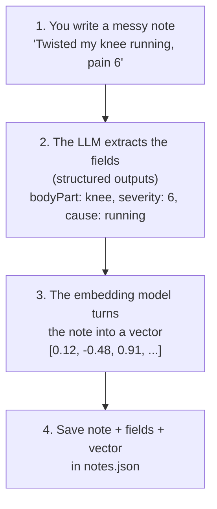
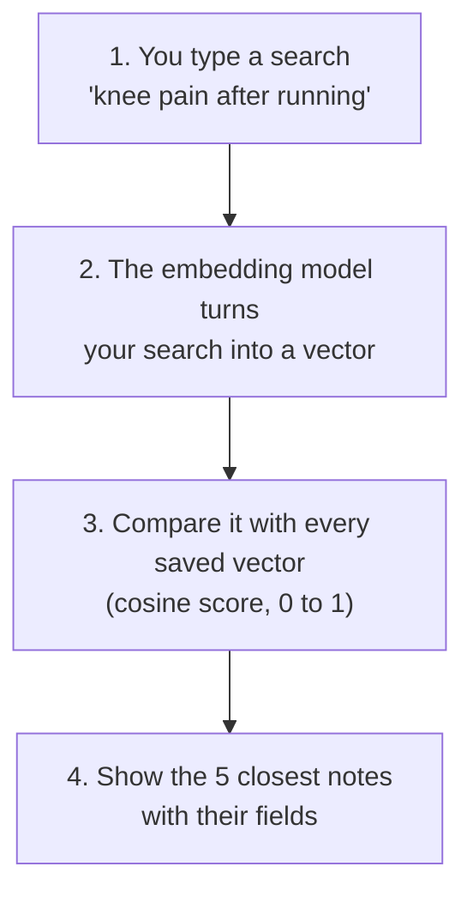

# Injury Semantic Search

Search my injury notes by meaning, not just keywords.

## How it works

Every RAG app has two flows: **indexing** (saving data) and **querying** (searching it). The extract step uses **structured outputs**: the LLM returns JSON in a fixed shape, validated with Zod.

### Indexing: when you save a note



### Querying: when you search



Details: [Structured extraction](docs/extraction.md)

## Status

- [x] Milestone 1: Project skeleton
- [ ] Milestone 2: Structured extraction (choose models)
- [ ] Milestone 3: Embed and persist
- [ ] Milestone 4: Cosine similarity with tests
- [ ] Milestone 5: CLI search
- [ ] Milestone 6: Threshold experiment
- [ ] Milestone 7: React search UI

## Tech stack

| Tool                | Why                                         |
| ------------------- | ------------------------------------------- |
| Node.js 20+         | Runtime; built-in `--env-file` loads `.env` |
| TypeScript (strict) | Type safety                                 |
| tsx                 | Runs `.ts` files directly, no build step    |
| Vitest              | Tests                                       |
| npm                 | Package manager                             |

LLM and embedding models: chosen in milestone 2 by benchmarking (local Ollama, free).

## Run locally

Requires Node.js 20+.

```bash
git clone https://github.com/sabrahermassi/injury-semantic-search.git
cd injury-semantic-search
npm install
```

Create a `.env` file in the project root:

```
APP_NAME=injury-semantic-search
```

## Scripts

| Command             | What it does   |
| ------------------- | -------------- |
| `npm start`         | Runs the app   |
| `npm test`          | Runs the tests |
| `npm run typecheck` | Checks types   |
