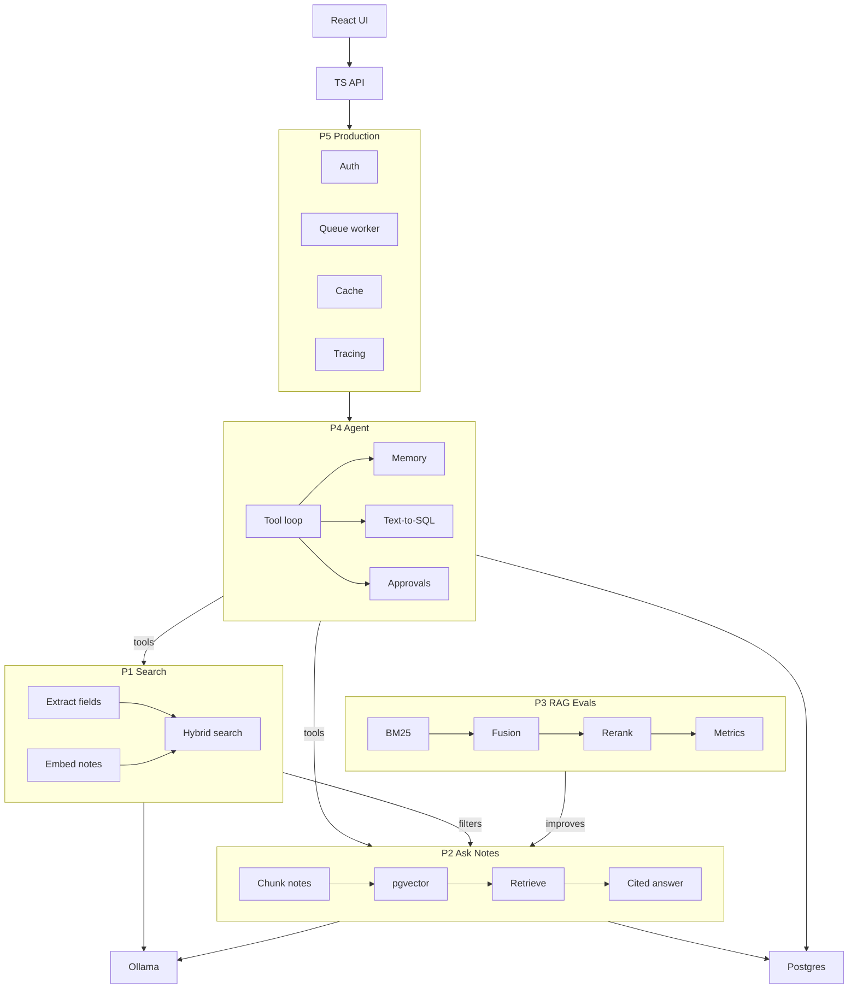

# Injury Journal AI Agent

An AI agent that searches, answers and acts on personal injury records. It turns messy notes into structured data, answers questions with citations verified word for word, refuses when the notes don't hold the answer, and takes actions through tools with human approval for every change. Built in 5 projects, each adding one capability on top of the last.

## The whole app



- **React UI → TS API**: the only public entry. The TS API checks every request and calls the Python AI service.
- **P5 Production** wraps everything: login, background processing of notes, a cache in front of answers, and tracing.
- **P4 Agent** is what you talk to: it decides which tool to call. Its tools are P1 search, P2 ask, and safe database queries.
- **P2 Ask Notes** answers questions from your notes with citations, using P1's filters, and P3's better retrieval.
- **Ollama** runs the models locally; **Postgres + pgvector** stores notes, chunks and vectors.

## The projects

| Project            | What it adds                                                                     | Status                                                                                           | Docs                                                   |
| ------------------ | -------------------------------------------------------------------------------- | ------------------------------------------------------------------------------------------------ | ------------------------------------------------------ |
| 1. Semantic search | Extract fields from messy notes, search by meaning with filters                  | ✅ done ([tag](https://github.com/sabrahermassi/injury-journal-ai-agent/tree/p1-semantic-search)) | [docs/semantic-search](docs/semantic-search/README.md) |
| 2. Ask my notes    | Chunk long notes in Postgres + pgvector, answer questions with checked citations | ✅ done                                                                                          | [docs/ask-notes](docs/ask-notes/README.md)             |
| 3. RAG evals       | Keyword + vector search, fusion, reranking, measured with hit rate and MRR       | 🚧 in progress                                                                                   |                                                        |
| 4. Agent           | Tool-calling loop with memory, guarded text-to-SQL and approvals                 | planned                                                                                          |                                                        |
| 5. Production      | Auth, queue with retries, semantic cache, tracing, evals in CI                   | planned                                                                                          |                                                        |

Each project's README explains how it works, its files, and its own commands.

## Folder structure

```
app/        Python AI service (FastAPI, port 8000): core/ shared, one folder per project
api/src/    TypeScript API (Express + Zod, port 3000): one folder per project
web/src/    React app (Vite, port 5173): one folder per project
tests/  eval/  data/  docs/   one folder per project, same names
```

Rule: a project imports only from `app/core/`, never from another project.

## Run the whole app

Requires Python 3.12+, [uv](https://docs.astral.sh/uv/), Node.js 22+, [Docker Desktop](https://www.docker.com/products/docker-desktop/) and [Ollama](https://ollama.com).

**Set up once**

```bash
git clone https://github.com/sabrahermassi/injury-journal-ai-agent.git
cd injury-journal-ai-agent
uv sync
(cd api && npm install)
(cd web && npm install)
ollama pull qwen2.5:3b
ollama pull nomic-embed-text
cp .env.example .env
docker compose up -d --wait
uv run --env-file .env python -m app.ask_notes.setup_db
```

**Start**, each in its own terminal:

| Terminal | Command                                         | Runs                 |
| -------- | ----------------------------------------------- | -------------------- |
| 1        | `docker compose up -d --wait`                   | Postgres, port 5432  |
| 2        | `uv run --env-file .env fastapi dev app/api.py` | Python AI, port 8000 |
| 3        | `cd api && npm run dev`                         | TS API, port 3000    |
| 4        | `cd web && npm run dev`                         | React, port 5173     |

Open http://localhost:5173.

## Commands

| Command                                        | What it does                              |
| ---------------------------------------------- | ----------------------------------------- |
| `docker compose up -d` / `docker compose down` | Start / stop Postgres (data is kept)      |
| `uv run --env-file .env pytest -q`             | All Python tests, database tests included |
| `uv run mypy app tests`                        | Python type checks                        |
| `cd api && npm test && npm run typecheck`      | TS API tests and type checks              |
| `cd web && npm run build && npm run lint`      | React build and lint                      |

Project-specific commands (benchmarks, indexing, experiments) are in each project's README.

## Tech stack

Python (FastAPI, Pydantic, uv, pytest, mypy) · TypeScript (Express, Zod, React, Vite, Vitest) · Postgres 17 + pgvector (psycopg 3) · Ollama (`qwen2.5:3b`, `nomic-embed-text`) · Docker Compose · GitHub Actions
