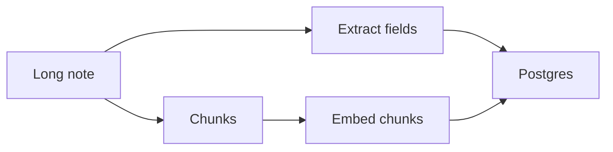
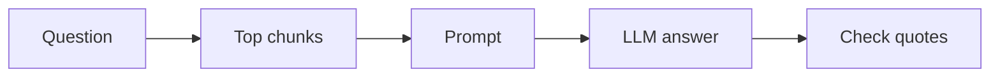

# Project 2: Ask my notes

Ask questions about your own long injury notes, and get answers that quote the exact passages.

## Files

| File                                              | Job                                                                                         |
| ------------------------------------------------- | ------------------------------------------------------------------------------------------- |
| `docker-compose.yml`                              | Runs Postgres 17 with pgvector                                                              |
| `app/core/db.py`                                  | Opens a database connection (shared)                                                        |
| `app/ask_notes/schema.sql`                        | The `notes` and `chunks` tables, their rules and indexes                                    |
| `app/ask_notes/setup_db.py`                       | Creates the tables; safe to run again                                                       |
| `tests/ask_notes/`                                | Its tests (the database tests need Postgres running)                                        |
| `app/ask_notes/chunker.py`                        | Splits a note into overlapping sentence chunks with offsets                                 |
| `app/ask_notes/ingest.py`                         | Saves a note: fields, chunks and vectors in one transaction; same note twice = no change    |
| `app/ask_notes/router.py`                         | Endpoint `POST /notes`                                                                      |
| `app/core/model_call.py`                          | Every Ollama call: 60 s timeout, one retry after 1 s, then a clear 503 (shared)             |
| `app/ask_notes/retrieve.py`                       | Question in, top-k closest chunks out: pgvector cosine plus field filters, one SQL query    |
| `app/ask_notes/evaluation/chunking_experiment.py` | Compares whole notes vs chunk sizes on the test questions                                   |
| `eval/ask_notes/questions.json`                   | 16 test questions, each with the note that answers it                                       |
| `app/ask_notes/evaluation/not_found.py`           | Checks unanswerable questions are refused and answerable ones answered; picks the threshold |
| `eval/ask_notes/unanswerable.json`                | 8 questions the test notes can't answer                                                     |

## How it works

Like every RAG app, it has two flows: **saving** notes and **asking** questions.

### Saving a note



- **Extract fields**: the LLM pulls out injury, body part, severity, cause and date (Project 1 code). They go in the `notes` table.
- **Chunks**: the long note is split into small overlapping pieces, so search can find the exact passage.
- **Embed chunks**: each piece becomes a vector. Pieces and vectors go in the `chunks` table.

### Asking a question



- **Top chunks**: pgvector finds the chunks closest in meaning, with the same filters as Project 1.
- **Prompt**: the numbered chunks and the question go to the LLM, with the rule "answer only from these".
- **Check quotes**: plain code checks that every quote really appears in its chunk. If not, the app refuses.
- If the notes don't contain the answer, the app says "I could not find that in your notes".

## Chunk size choice

`app/ask_notes/evaluation/chunking_experiment.py` searched 16 test questions (`eval/ask_notes/questions.json`) against the 20 test notes with each setting. Top-1: the right note came first. Top-3: it was in the first 3.

| Setting                  | Pieces | Top-1     | Top-3     |
| ------------------------ | ------ | --------- | --------- |
| Whole note               | 20     | 12/16     | 15/16     |
| **Small 300, overlap 1** | **74** | **13/16** | **16/16** |
| Medium 600, overlap 1    | 40     | 11/16     | 15/16     |
| Medium 600, overlap 0    | 40     | 11/16     | 15/16     |
| Large 1000, overlap 1    | 20     | 12/16     | 15/16     |

Chose **300 characters with 1 sentence of overlap**: best on both scores, and the only setting with every right note in the top 3. The gap is 1–2 questions, so it's a lean, not proof; to be rerun with real notes. Large 1000 equals the whole note because the test notes are shorter than 1,000 characters.

```bash
uv run --env-file .env python -m app.ask_notes.evaluation.chunking_experiment
```

## Trade-offs

| Choice                                              | Instead of                           | Why                                                                                                                                                             |
| --------------------------------------------------- | ------------------------------------ | --------------------------------------------------------------------------------------------------------------------------------------------------------------- |
| Postgres + pgvector                                 | A vector database (Pinecone, Qdrant) | One system, filters and vectors in one query; less tuned for huge scale                                                                                         |
| HNSW index                                          | Exact search                         | Much faster at scale; can miss a few true matches. Filtered search ranks exactly, which is fine for one person's notes                                          |
| psycopg + plain SQL                                 | An ORM (SQLAlchemy)                  | You see and learn the real SQL; more code by hand                                                                                                               |
| Sentence chunks, 300 characters, 1 sentence overlap | Whole notes, or bigger chunks        | Won the chunking experiment (13/16 top-1, 16/16 top-3); more embeddings to store                                                                                |
| Quote check in plain code, retry once, then refuse  | Trust the model's answer             | An invented quote is always caught; it can't prove the answer agrees with its quotes (LLM judge in Project 3)                                                   |
| Timeout + one retry on model calls                  | No timeout, or many retries          | A stuck model can't hang a request; a real outage fails fast with a clear 503                                                                                   |
| Local Docker Postgres                               | A managed cloud database             | Free and easy now; backups are on you                                                                                                                           |
| Threshold 0.65 plus "found: false" in the prompt    | Threshold only                       | Scores overlap (answerable 0.69–0.83, unanswerable 0.51–0.70), so the threshold blocks most cheaply and the model catches the rest; 8/8 refused, 15/16 answered |

## Run locally

Set up the whole app first (root README): it starts Postgres and creates the tables. Look inside the database:

```bash
docker compose exec db psql -U injury -d injury_ai -c "\dt" -c "\d chunks"
```

## Commands

| Command                                                   | What it does                               |
| --------------------------------------------------------- | ------------------------------------------ |
| `uv run --env-file .env python -m app.ask_notes.setup_db` | Creates the tables (safe to repeat)        |
| `uv run --env-file .env pytest -q tests/ask_notes`        | This project's tests, on the real database |

## Docs

- [Postgres and pgvector](postgres-pgvector.md): the tables, keys, indexes, how HNSW search works, and the trade-offs.

## Status

- [x] Milestone 1: Postgres + pgvector
- [x] Milestone 2: Test notes
- [x] Milestone 3: Chunker with tests
- [x] Milestone 4: Ingest endpoint
- [x] Milestone 5: Resilient model calls
- [x] Milestone 6: Retrieval function
- [x] Milestone 7: Chunking experiment
- [x] Milestone 8: Grounded answer
- [x] Milestone 9: Not-found behavior
- [ ] Milestone 10: Chat UI
- [ ] Milestone 11: Input check
- [ ] Milestone 12: 20 test questions
- [ ] Milestone 13: Write your notes
