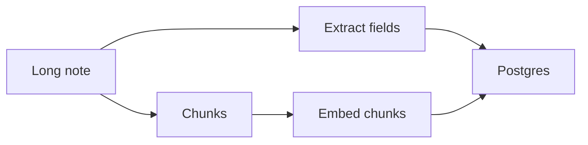
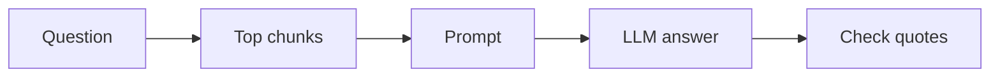

# Project 2: Ask my notes

Ask questions about your own long injury notes, and get answers that quote the exact passages.

## Files

| File                        | Job                                                                                      |
| --------------------------- | ---------------------------------------------------------------------------------------- |
| `docker-compose.yml`        | Runs Postgres 17 with pgvector                                                           |
| `app/core/db.py`            | Opens a database connection (shared)                                                     |
| `app/ask_notes/schema.sql`  | The `notes` and `chunks` tables, their rules and indexes                                 |
| `app/ask_notes/setup_db.py` | Creates the tables; safe to run again                                                    |
| `tests/ask_notes/`          | Its tests (the database tests need Postgres running)                                     |
| `app/ask_notes/chunker.py`  | Splits a note into overlapping sentence chunks with offsets                              |
| `app/ask_notes/ingest.py`   | Saves a note: fields, chunks and vectors in one transaction; same note twice = no change |
| `app/ask_notes/router.py`   | Endpoint `POST /notes`                                                                   |
| `app/core/model_call.py`    | Every Ollama call: 60 s timeout, one retry after 1 s, then a clear 503 (shared)          |

## How it works

Like every RAG app, it has two flows: **saving** notes and **asking** questions.

### Saving a note



- **Extract fields**: the LLM pulls out injury, body part, severity, cause and date (Project 1 code). They go in the `notes` table.
- **Chunks**: the long note is split into small overlapping pieces, so search can find the exact passage.
- **Embed chunks**: each piece becomes a vector. Pieces and vectors go in the `chunks` table.

### Asking a question



- **Top chunks**: pgvector finds the chunks closest in meaning, with the same filters as Project 1.
- **Prompt**: the numbered chunks and the question go to the LLM, with the rule "answer only from these".
- **Check quotes**: plain code checks that every quote really appears in its chunk. If not, the app refuses.
- If the notes don't contain the answer, the app says "I could not find that in your notes".

## Trade-offs

| Choice                       | Instead of                           | Why                                                                                      |
| ---------------------------- | ------------------------------------ | ---------------------------------------------------------------------------------------- | --- | ------------------ | ---------- | --------------------------------------------------------------- |
| Postgres + pgvector          | A vector database (Pinecone, Qdrant) | One system, filters and vectors in one query; less tuned for huge scale                  |
| HNSW index                   | Exact search                         | Much faster; can miss about 1–5% of true matches, slower saves                           |
| psycopg + plain SQL          | An ORM (SQLAlchemy)                  | You see and learn the real SQL; more code by hand                                        |
| Fields as columns            | A JSON column                        | Indexes and database rules work; a new field needs a schema change                       |
| `user_id` from day one       | Adding it with login                 | No migration in Project 5                                                                |
| Content hash                 | Allowing duplicates                  | Same note can't be saved twice; a one-letter edit counts as new                          |
| Sentence chunks              | Fixed-size chunks                    | Keeps whole sentences unless one is longer than the limit; chunk sizes vary              |     | 1 sentence overlap | No overlap | Context kept at chunk edges; text stored twice, more embeddings |
| 600 characters per chunk     | Bigger or smaller chunks             | Small enough to cite exactly, big enough to keep meaning; tested in milestone 7          |
| Local Docker Postgres        | A managed cloud database             | Free and easy now; backups are on you                                                    |
| Fields from the whole note   | Fields per chunk                     | One extraction call per note; a note with several injuries gets only the main one        |
| Skip models if already saved | Always re-run                        | Saving twice costs nothing; an edited note counts as a new note                          |
| One retry after 1 s          | Many retries                         | Recovers from a blip; a real outage fails fast instead of making the user wait           |
| 60 s timeout                 | No timeout                           | A stuck model can't hang a request forever; a very slow but working model may be cut off |
| Retry only temporary errors  | Retry everything                     | Our own mistakes (wrong model name) fail at once, not twice                              |

## Run locally

Set up the whole app first (root README): it starts Postgres and creates the tables. Look inside the database:

```bash
docker compose exec db psql -U injury -d injury_ai -c "\dt" -c "\d chunks"
```

## Commands

| Command                                                   | What it does                               |
| --------------------------------------------------------- | ------------------------------------------ |
| `uv run --env-file .env python -m app.ask_notes.setup_db` | Creates the tables (safe to repeat)        |
| `uv run --env-file .env pytest -q tests/ask_notes`        | This project's tests, on the real database |

## Docs

- [Postgres and pgvector](postgres-pgvector.md): the tables, keys, indexes, how HNSW search works, and the trade-offs.

## Status

- [x] Milestone 1: Postgres + pgvector
- [x] Milestone 2: Test notes
- [x] Milestone 3: Chunker with tests
- [x] Milestone 4: Ingest endpoint
- [x] Milestone 5: Resilient model calls
- [ ] Milestone 6: Retrieval function
- [ ] Milestone 7: Chunking experiment
- [ ] Milestone 8: Grounded answer
- [ ] Milestone 9: Not-found behavior
- [ ] Milestone 10: Chat UI
- [ ] Milestone 11: Input check
- [ ] Milestone 12: 20 test questions
- [ ] Milestone 13: Write your notes
