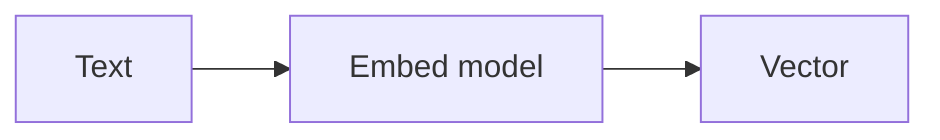
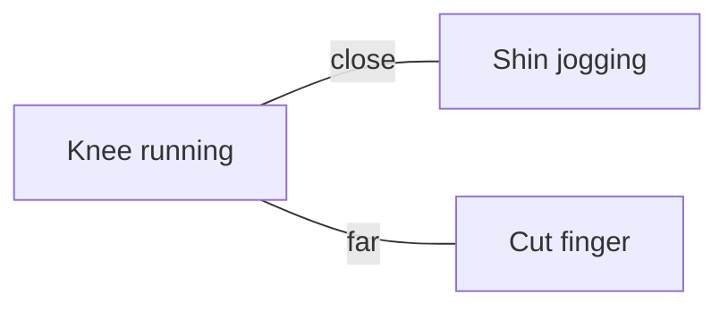
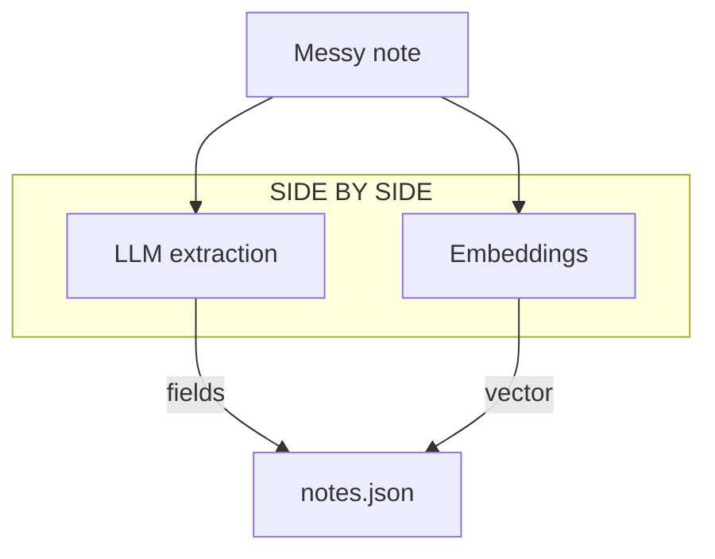
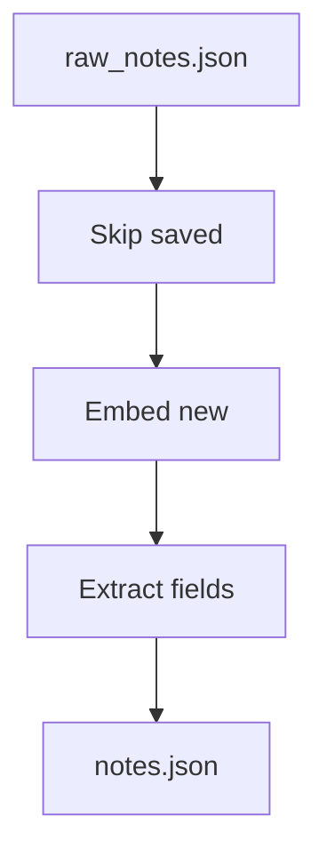
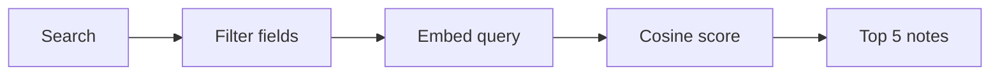
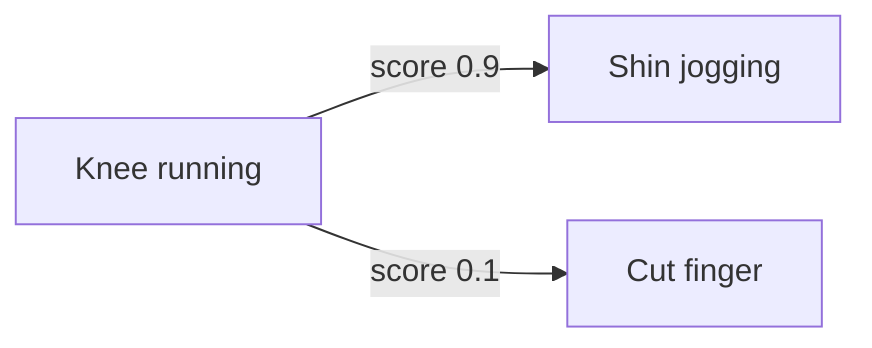
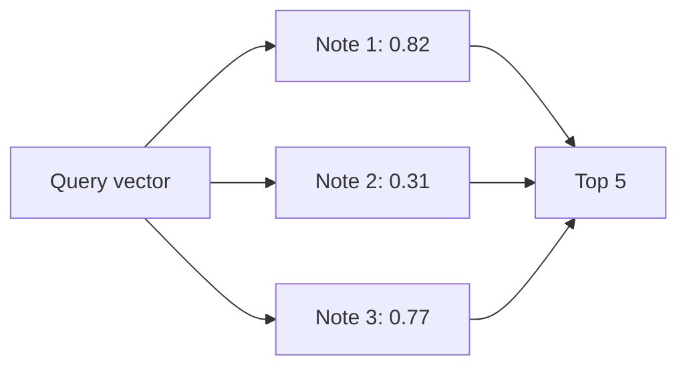

# Embedding model

|                    |                                                                              |
| ------------------ | ---------------------------------------------------------------------------- |
| **Model**          | `nomic-embed-text` (via Ollama), chosen by benchmark in milestone 4          |
| **Type**           | Embedding model (not generative: it never writes text)                       |
| **What it does**   | Text in, vector out (a list of numbers)                                      |
| **Why we need it** | Lets the app find notes **by meaning**, not by exact words (semantic search) |

## Part 1: How embedding models work (the general idea)

### What a vector is

An embedding model turns text into a **list of numbers**, called a vector. `nomic-embed-text` gives 768 numbers per text.



- **Text**: `"knee pain after running"`
- **Vector**: `[0.012, -0.044, 0.091, ...]`, 768 numbers

You can't read the numbers, but they encode **meaning**. Texts with similar meaning get vectors that point in a similar direction.



- **Close:** "knee pain after running" and "hurt my shin jogging" have similar meaning.
- **Far:** "cut my finger chopping onions" means something different.

That's why "running injury" can find "hurt my shin jogging" even though the two share no words.

### LLM vs embedding model

|          | LLM (`qwen2.5:3b`) | Embedding model (`nomic-embed-text`) |
| -------- | ------------------ | ------------------------------------ |
| Output   | Text               | Numbers (a vector)                   |
| Size     | ~1.9 GB            | ~274 MB                              |
| Speed    | ~1 s per note      | Milliseconds per note                |
| Used for | Extraction         | Search by meaning                    |

### The rules

1. **Use the same model for notes and for search questions.** Vectors from different models are not comparable.
2. **Never mix models in one store.** Changing the model means re-embedding every note.
3. **Some models need a prefix.** `nomic-embed-text` expects `search_document: ` before notes and `search_query: ` before questions. Without it, results get worse with no error.
4. **You can't turn a vector back into text.** Always keep the original note.

### Settings we use

```python
client.embed(
    model="nomic-embed-text",                                                 # which embedding model
    input=["search_document: knee pain 5/10", "search_document: sore neck"],  # one or more texts, with the prefix
)
# response.embeddings → one vector per text, in the same order
```

Compared with `client.chat`:

| `client.chat` (LLM)                       | `client.embed` (embedding model)                                     |
| ----------------------------------------- | -------------------------------------------------------------------- |
| `messages`: a conversation with roles     | `input`: just a list of texts, no roles                              |
| `format="json"`, `temperature=0`          | No format or temperature: the same text always gives the same vector |
| Returns text (`response.message.content`) | Returns vectors (`response.embeddings`)                              |
| One conversation per call                 | Many texts per call (batching), which is faster                      |

## Part 2: How our embedding works

### Saving notes (indexing)

The same note goes to both models, side by side:



- **LLM extraction**: `"Twisted my knee running, pain 6"` becomes `{ body_part: "knee", severity: 6, cause: "running" }`. Used for filters, display and charts.
- **Embeddings**: the note text becomes `[0.12, -0.48, 0.91, ...]`. Used for search by meaning.
- Both are saved together as one record in `data/notes.json`.

First create `data/raw_notes.json`: a UTF-8 JSON array of strings, one note each. `data/` is in `.gitignore`, so it isn't in the repo.

```json
["knee pain after running", "lower back hurts after sitting all day"]
```

Then run:

```bash
uv run --env-file .env python -m app.index
```

What the command does:



- **Skip saved**: notes already saved with this model are skipped (`note_id` is a fingerprint of the text).
- **Embed new**: all new notes in one call, with `search_document: `.
- **Extract fields**: the LLM, one note at a time.
- **notes.json**: one record per note: `{ id, text, fields, vector, embed_model }`.

### Searching (hybrid)

`search(query, records, embed_model, filters)` in `app/search.py` uses the results of **both** models:



- **Filter fields**: keep only notes whose extracted fields pass the filters (`body_part`, `min_severity`). This is the extraction side. If no note passes, it returns an empty list straight away, with no model call.
- **Embed query**: the question gets the `search_query: ` prefix. The vector is not saved.
- **Cosine score**: each remaining note's vector is compared with the question's vector. This is the embedding side.
- **Top 5 notes**: sorted from highest score to lowest, returned with their text, fields and score (no vector).

### The files

| File                          | Job                                                                                   |
| ----------------------------- | ------------------------------------------------------------------------------------- |
| `app/embedding/embed.py`      | `embed_documents` (notes) and `embed_query` (search questions), with the right prefix |
| `app/embedding/similarity.py` | `cosine_similarity`: how similar two vectors are (−1 to 1)                            |
| `app/embedding/benchmark.py`  | Compares embedding models and text options on test questions                          |
| `app/store.py`                | `NoteRecord`, plus `load` and `save` for `data/notes.json`                            |
| `app/index.py`                | The pipeline: skip, embed, extract, save                                              |
| `app/search.py`               | `search()`: hybrid search, filter by fields then rank by cosine, top 5                |

### How the model was chosen

`app/embedding/benchmark.py` searched 12 test questions (`eval/queries.json`) against the 10 test notes, with 3 models (nomic-embed-text, mxbai-embed-large, all-minilm) and 3 text options (raw note, extracted fields, both). Every combination found the right note in the top 3 for all 12 questions, so the test set is too small to separate them. We kept **nomic-embed-text with the raw note**: small, handles long notes, and keeps search independent of extraction mistakes. To be rerun with real notes.

## Cosine similarity

### What it measures

Cosine similarity scores how much two vectors **point in the same direction**: how similar the two texts are in meaning. It ignores the vectors' length and only looks at direction.



- **Small angle, score close to 1:** similar meaning.
- **Big angle, score close to 0:** unrelated.

| Score | Angle | Meaning                      |
| ----- | ----- | ---------------------------- |
| 1     | 0°    | Same direction: same meaning |
| 0     | 90°   | Unrelated                    |
| −1    | 180°  | Opposite direction           |

Text embeddings almost always score between 0 and 1.

### The formula

```text
cosine(a, b) = (a · b) / (|a| × |b|)

a · b  = dot product = a[0]*b[0] + a[1]*b[1] + ...   multiply pairs, add them up
|a|    = length      = sqrt(a[0]² + a[1]² + ...)      Pythagoras in many dimensions
```

A small example with 2 numbers instead of 768:

```text
a = [1, 2]    b = [2, 4]
a · b = 1×2 + 2×4 = 10
|a| = sqrt(1 + 4)  = 2.236
|b| = sqrt(4 + 16) = 4.472
cosine = 10 / (2.236 × 4.472) = 1.0     ← b is just a longer copy of a: same direction
```

### Rules

1. **Both vectors must have the same length**, which means they come from the same model. Otherwise it raises `ValueError`.
2. **A zero vector has no direction,** so it raises `ValueError`.
3. **Scaling doesn't change the score:** `[1, 2]` and `[10, 20]` score 1.

### In our code

`cosine_similarity(a, b)` in `app/embedding/similarity.py`, without a library, and tested in `tests/test_similarity.py`:

| Test                           | Checks                   |
| ------------------------------ | ------------------------ |
| identical vectors              | score 1                  |
| orthogonal vectors             | score 0                  |
| opposite vectors               | score −1                 |
| scaled vector                  | still 1 (direction only) |
| different lengths, zero vector | raise `ValueError`       |

### How search uses it



The query vector is compared with every note's vector, the scores are sorted from high to low, and the top 5 are kept.

In production, vector databases (pgvector, Qdrant) compute this for you, with indexes that avoid comparing against every vector.
