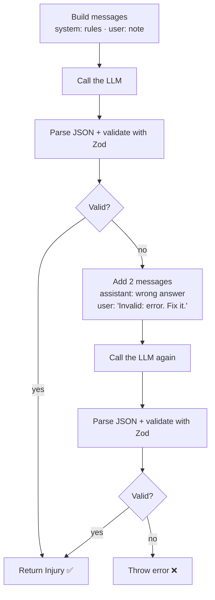

# Structured extraction

`extract(note, model?)` turns a messy note into a validated `Injury` object.

- **In:** `"Twisted my left ankle playing football yesterday, pain about 7"`
- **Out:** `{ injury: "twisted ankle", bodyPart: "left ankle", severity: 7, cause: "football", date: null }`

## Why a retry?

LLMs sometimes return wrong JSON. Sending the Zod error back lets the model fix its own mistake.
