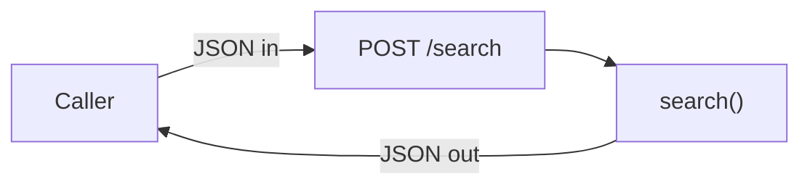
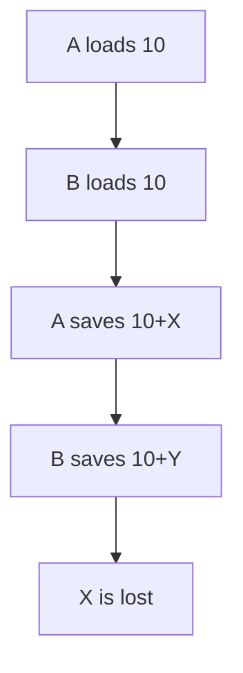

# FastAPI endpoints

|                    |                                                                         |
| ------------------ | ----------------------------------------------------------------------- |
| **Tool**           | FastAPI (Python web framework), run with `fastapi dev`                  |
| **Port**           | 8000 (FastAPI's default)                                                |
| **What it does**   | Turns Python functions into URLs other programs can call over HTTP      |
| **Why we need it** | The TS API and React can't import Python files, but they can call a URL |

## Part 1: How endpoints work (the general idea)

### What an endpoint is

An **endpoint** is a URL plus a method (like `POST /search`) that runs one function on the server.



- **Caller**: anything that can send HTTP. Later, the TS API. For now, the `/docs` page.
- **JSON in**: the request body, for example `{ "query": "knee pain" }`.
- **JSON out**: the response, for example a list of notes with scores.

### GET vs POST

| Method | Used for                        | Has a body? |
| ------ | ------------------------------- | ----------- |
| `GET`  | Read something, no side effects | No          |
| `POST` | Send data: create, run, search  | Yes (JSON)  |

We use `POST` for all 3 endpoints because each one takes a JSON body.

### Pydantic checks the request

Each endpoint has a request model, for example:

```python
class SearchRequest(BaseModel):
    query: str = Field(min_length=1)
    filters: SearchFilters | None = None
    top_k: int = Field(default=5, ge=1, le=50)
    min_score: float = Field(default=0.53, ge=-1, le=1)
```

FastAPI checks the JSON against it **before** your function runs. If it's wrong (an empty query, or `top_k = 0`), the caller gets a `422` and your function never runs.

### Status codes

| Code  | Meaning                                | When we return it                     |
| ----- | -------------------------------------- | ------------------------------------- |
| `200` | OK                                     | It worked                             |
| `422` | Your request is invalid                | Pydantic rejected the body            |
| `502` | Something the server depends on failed | The LLM returned invalid fields twice |
| `500` | Unexpected server error                | For example, Ollama isn't running     |

### The `/docs` page

FastAPI builds a test page from your request models, for free: http://localhost:8000/docs. Each endpoint has a **Try it out** button: you type a JSON body, click **Execute** and see the response. That's why we don't need a CLI.

## Part 2: Our endpoints

### The 3 endpoints

| Endpoint        | You send                               | You get back                             | Calls              |
| --------------- | -------------------------------------- | ---------------------------------------- | ------------------ |
| `POST /extract` | `{ "note": "..." }`                    | The 5 fields. Nothing is saved.          | `extract()`        |
| `POST /index`   | `{ "notes": ["...", "..."] }`          | `{ total, added, rebuilt }`              | `index_and_save()` |
| `POST /search`  | `{ query, filters, top_k, min_score }` | Top notes with `text`, `fields`, `score` | `search()`         |

`app/api.py` is a thin layer: it checks the request and calls the functions from milestones 2 to 5. No AI logic lives there.
Milestone 8 added `GET /body-parts` (every body part in the saved notes, for the UI's dropdown) and the `date_from` / `date_to` filters on `/search`.

### Where it sits


- **React UI** (milestone 8) calls the **TS API**.
- **TS API** calls these endpoints on port 8000.
- **FastAPI** calls Ollama for the models.

### Run it

```bash
uv run --env-file .env fastapi dev app/api.py
```

Then open http://localhost:8000/docs and try `/search` with:

```json
{ "query": "running injury", "filters": { "body_part": "knee" }, "top_k": 3 }
```

`fastapi dev` restarts the server by itself when you change a file.

## The lost-update race

### The problem

With a server, two `/index` calls can arrive at the same time:



- **A** and **B** both load the store with 10 notes.
- **A** adds note X and saves 11 notes.
- **B** adds note Y to **its own old copy** and saves 11 notes, without X.
- Note X is gone, with no error.

### The fix: a lock

```python
store_lock = threading.Lock()

with store_lock:
    before = load(path)
    records = index_notes(notes, before, embed_model)
    save(records, path)
```

- Only one call can be inside `with store_lock:` at a time. The second call **waits** until the first one has saved.
- Then it loads the store **with X already in it**, adds Y, and saves both.

### The options we compared

| Option                       | Pros                                     | Cons                                 |
| ---------------------------- | ---------------------------------------- | ------------------------------------ |
| **Lock** (chosen)            | About 5 lines, easy to understand        | Only works inside one server process |
| SQLite, transaction + upsert | Works across processes, one row per note | Rewrite of `store.py`                |
| Postgres (Project 2)         | Real database, many servers              | Needs a database server              |

We chose the lock: we run one process, and Project 2 moves to Postgres anyway, so SQLite would be rewritten twice.

## Tests

| File                 | Test                                  | Checks                                                     |
| -------------------- | ------------------------------------- | ---------------------------------------------------------- |
| `tests/test_api.py`  | extract returns fields                | `/extract` returns `200` and the fields                    |
| `tests/test_api.py`  | extract rejects empty note            | an empty note gets `422`                                   |
| `tests/test_api.py`  | index then search                     | `/index` saves 2 notes, `/search` finds them with a filter |
| `tests/test_race.py` | two overlapping saves keep both notes | two `/index` calls at the same time keep both notes        |

- The API tests use `TestClient`: it calls the endpoints without starting a real server.
- Fake models (`monkeypatch`) and a temporary folder (`tmp_path`), so no Ollama is needed and `data/notes.json` is never touched.
- The race test uses a slow fake embed (0.2 s), so both calls really overlap. Without the lock, this test fails.

## Read more

- FastAPI tutorial: https://fastapi.tiangolo.com/tutorial/
- Request body with Pydantic: https://fastapi.tiangolo.com/tutorial/body/
- Testing with `TestClient`: https://fastapi.tiangolo.com/tutorial/testing/
- Python `threading.Lock`: https://docs.python.org/3/library/threading.html#lock-objects
