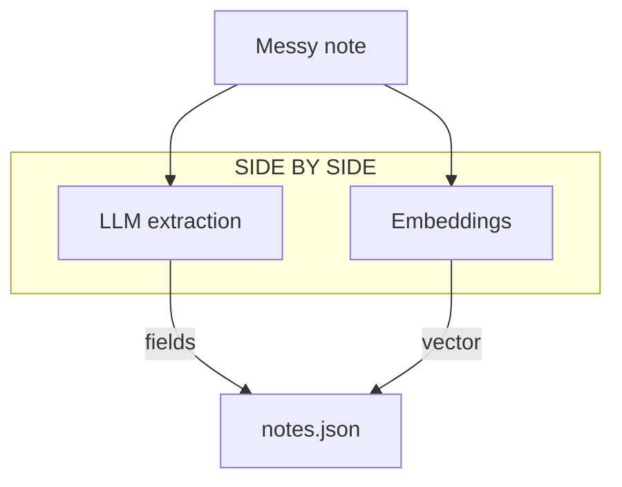
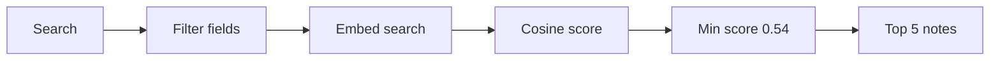

# Project 1: Semantic search

Search injury notes by meaning, and filter by the fields an LLM extracted from each note. Finished version: tag [p1-semantic-search](https://github.com/sabrahermassi/injury-semantic-search/tree/p1-semantic-search).

## Files

| File                              | Job                                                             |
| --------------------------------- | --------------------------------------------------------------- |
| `app/semantic_search/extraction/` | The LLM turns a messy note into validated fields (`Injury`)     |
| `app/semantic_search/store.py`    | `NoteRecord`, and atomic load and save of the notes file        |
| `app/semantic_search/index.py`    | Skip saved notes, embed new ones, extract their fields, save    |
| `app/semantic_search/search.py`   | Hybrid search: filter by fields, rank by cosine, threshold      |
| `app/semantic_search/router.py`   | Endpoints `/extract`, `/index`, `/body-parts`, `/search`        |
| `app/semantic_search/evaluation/` | Extraction benchmark, embedding benchmark, threshold experiment |
| `api/src/semantic-search/`        | TS API routes, Zod schemas, Python client                       |
| `web/src/semantic-search/`        | The search page                                                 |
| `tests/semantic_search/`          | Its tests                                                       |

## How it works

Every RAG app has two flows: **indexing** (saving data) and **querying** (searching it).

### Indexing: when you save a note



The same note goes to **both** models, side by side:

- **LLM extraction** (structured outputs): `"Twisted my knee running, pain 6"` becomes `{ body_part: "knee", severity: 6, cause: "running" }`, validated with Pydantic. Used for filters, display and charts.
- **Embeddings**: the note text becomes a vector `[0.12, -0.48, 0.91, ...]`. Used for search by meaning.
- Both are saved together as one record in `data/semantic_search/notes.json`.

### Querying: when you search



- **Search** plus optional filters, for example `"pain after running"` with `body_part = knee`.
- **Filter fields** keeps only notes whose extracted fields match.
- **Embed search** turns the search into a vector (not saved).
- **Cosine score** compares it with each remaining note's vector.
- **Min score 0.54** drops weak matches, so an off-topic search returns nothing.
- **Top 5 notes** are shown with their fields, highest score first.

## Learn more

- [Structured extraction](structured-extraction.md): the LLM, how `messages` and roles work, and how a messy note becomes validated fields.
- [Embedding model](embedding-model.md): what vectors are, the rules for using them, how notes are embedded and saved, and cosine similarity.
- [FastAPI endpoints](fastapi-endpoints.md): the 3 endpoints, the `/docs` test page, and how the lock stops two saves from losing a note.
- [Score threshold](threshold.md): why search needs a minimum score, and how 0.54 was chosen by experiment.
- [Search UI](search-ui.md): how React, the TS API and Python connect, and what each layer checks.

## Status

- [x] Milestone 1: Project skeleton (Python)
- [x] Milestone 2: Structured extraction (Python)
- [x] Milestone 3: Embed and persist
- [x] Milestone 4: Cosine similarity with tests
- [x] Milestone 5: search function (hybrid)
- [x] Milestone 6: FastAPI endpoints
- [x] Milestone 7: threshold experiment
- [x] Milestone 8: React search UI

## Extraction model choice

Each model extracted 5 fields from the same 10 labelled test notes (`eval/semantic_search/notes.json`), and `app/semantic_search/evaluation/extraction_benchmark.py` compared its answers to the expected ones.

| Model          | Correct | Failed | Speed         |
| -------------- | ------- | ------ | ------------- |
| llama3.2       | 78%     | 0      | 1.2s/note     |
| **qwen2.5:3b** | **86%** | **0**  | **1.2s/note** |
| qwen2.5:7b     | 88%     | 0      | 2.4s/note     |

Chose **qwen2.5:3b**: only 1 field fewer than the 7B model (43 vs 44 out of 50), twice as fast, and smaller.

To run the benchmark yourself, pull all 3 models, then run it:

```bash
ollama pull llama3.2
ollama pull qwen2.5:3b
ollama pull qwen2.5:7b
uv run --env-file .env python -m app.semantic_search.evaluation.extraction_benchmark
```

## Embedding model choice

12 test questions (`eval/semantic_search/queries.json`) were searched against the 10 test notes with each model and each text option, using `app/semantic_search/evaluation/embedding_benchmark.py`. Top-1: the right note came first. Top-3: it was in the first 3.

| Model                | Text          | Top-1     | Top-3     |
| -------------------- | ------------- | --------- | --------- |
| **nomic-embed-text** | **raw**       | **11/12** | **12/12** |
| nomic-embed-text     | both          | 12/12     | 12/12     |
| mxbai-embed-large    | all 3         | 12/12     | 12/12     |
| all-minilm           | raw           | 11/12     | 12/12     |
| all-minilm           | fields / both | 12/12     | 12/12     |

All options found the right note in the top 3, so the test set is too small to separate them. Chose **nomic-embed-text with the raw note**: same accuracy, small (274 MB), handles long notes, and embedding the raw note keeps search independent of extraction mistakes. To be rerun with real notes.

To run it yourself: `ollama pull mxbai-embed-large`, `ollama pull all-minilm`, then `uv run --env-file .env python -m app.semantic_search.evaluation.embedding_benchmark`.

## Run locally

Set up the whole app first (root README). Then create `data/semantic_search/raw_notes.json`: a UTF-8 JSON array of strings, one note each. `data/` is in `.gitignore`, so personal notes are never committed.

```json
["knee pain after running", "lower back hurts after sitting all day"]
```

Index them, then start the app (root README) and open http://localhost:5173, or try the endpoints on http://localhost:8000/docs:

```bash
uv run --env-file .env python -m app.semantic_search.index
```

## Commands

| Command                                                                                | What it does                         |
| -------------------------------------------------------------------------------------- | ------------------------------------ |
| `uv run --env-file .env python -m app.semantic_search.index`                           | Extracts, embeds and saves new notes |
| `uv run --env-file .env python -m app.semantic_search.evaluation.extraction_benchmark` | Extraction benchmark                 |
| `uv run --env-file .env python -m app.semantic_search.evaluation.embedding_benchmark`  | Embedding benchmark                  |
| `uv run --env-file .env python -m app.semantic_search.evaluation.threshold`            | Threshold experiment                 |
| `uv run pytest -q tests/semantic_search`                                               | This project's tests                 |
