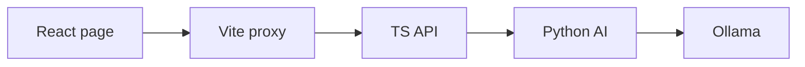
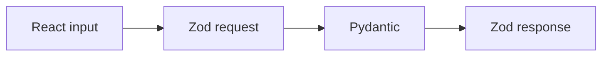

# Search UI

|                  |                                                                      |
| ---------------- | -------------------------------------------------------------------- |
| **Page**         | React + Vite in `web/`, localhost:5173                               |
| **TS API**       | Express + Zod in `api/`, localhost:3000                              |
| **Python AI**    | FastAPI in `app/`, localhost:8000                                    |
| **What it does** | Search by meaning, filter by extracted fields, show score and fields |

## How a search travels

- **React page**: you type a search and set filters. It sends `POST /api/search` with `{ query, filters }`.
- **Vite proxy**: in development, Vite forwards every `/api/...` call to port 3000. The browser only talks to one address, so there's no CORS setup.
- **TS API**: checks the request with Zod, calls Python's `POST /search`, checks Python's answer with Zod, and returns it.
- **Python AI**: filters by fields, embeds the question, scores with cosine, applies the 0.54 threshold, and keeps the top 5.
- **Ollama**: runs the embedding model for the question.

## Both models on one page

| On the page                        | Comes from           |
| ---------------------------------- | -------------------- |
| Body part dropdown, severity, date | Extraction (the LLM) |
| Fields shown under each note       | Extraction (the LLM) |
| Order of the results, the score    | Embeddings (cosine)  |

## The endpoints

| Layer  | Endpoint              | Job                                           |
| ------ | --------------------- | --------------------------------------------- |
| TS API | `GET /api/body-parts` | Fills the dropdown (calls Python)             |
| TS API | `POST /api/search`    | Validates, then calls Python's `/search`      |
| Python | `GET /body-parts`     | Every body part in the saved notes, once      |
| Python | `POST /search`        | Hybrid search, now with `date_from`/`date_to` |

The TS endpoints are **public** (React calls them). The Python endpoints are **internal** (only the TS API calls them).

## Each layer checks what comes into it

- **Zod request** (TS API): empty search or a date not in `YYYY-MM-DD` gives `400`, and Python is never called.
- **Pydantic** (Python): checks the request again (for example severity 1 to 10). An invalid request gives `422`.
- **Zod response** (TS API): checks Python's answer before sending it to React, so a broken answer never reaches the page.
- **Python down**: the TS API answers `502` and the page shows "Search failed".

## The filters

| Control         | Sent as                  | Python keeps notes where…            |
| --------------- | ------------------------ | ------------------------------------ |
| Body part       | `body_part`              | the body part contains it (any case) |
| Severity slider | `min_severity` (0 = any) | severity ≥ the value                 |
| From / To       | `date_from`, `date_to`   | the date is inside the range         |

- Only the filters that are set are sent.
- A note with no severity or no date is hidden when that filter is set.

## Tests

| File                    | Checks                                                                                                   |
| ----------------------- | -------------------------------------------------------------------------------------------------------- |
| `api/tests/semantic-search.test.ts` | valid search reaches Python; empty query and bad date give 400; Python down gives 502; body parts listed |
| `tests/semantic_search/test_search.py`  | date range keeps notes inside it; notes with no date are skipped                                         |
| `tests/semantic_search/test_api.py`     | `/body-parts` lists each part once                                                                       |

The TS API tests use a **fake Python client**, so they need nothing running. `supertest` calls the Express app without starting a server, like FastAPI's `TestClient`.

## Read more

- Vite server proxy: https://vite.dev/config/server-options#server-proxy
- Zod: https://zod.dev
- Express: https://expressjs.com
- React `useState` and `useEffect`: https://react.dev/reference/react
