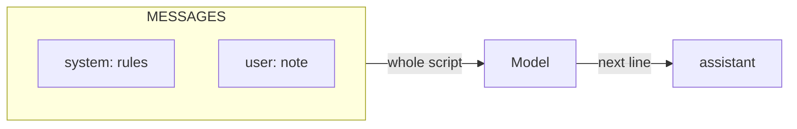
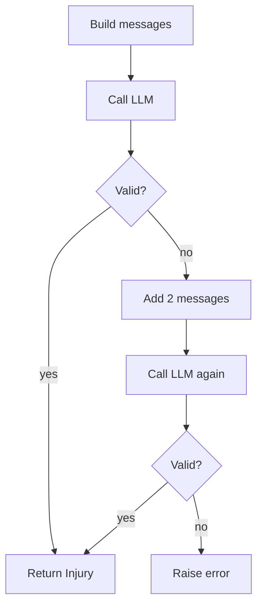
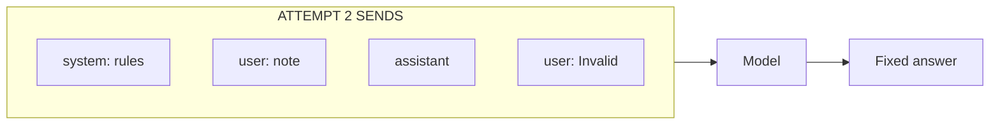

# Structured extraction

|                    |                                                                                                                               |
| ------------------ | ----------------------------------------------------------------------------------------------------------------------------- |
| **Model**          | `qwen2.5:3b` (via Ollama)                                                                                                     |
| **Type**           | LLM: generative chat model                                                                                                    |
| **What it does**   | Text in, structured data out                                                                                                  |
| **Why we need it** | Turns a messy injury note into fields (`injury`, `body_part`, `severity`, `cause`, `date`) the app can show, filter and chart |

## Part 1: How we talk to LLMs (the general idea)

### What `messages` is

`messages` is the **script of a conversation**. The model reads the whole script, then writes the **next line**.

Each message has two parts:

- `role`: who is speaking
- `content`: what they said

```python
messages = [
    {"role": "system", "content": "You extract injury data. Use null, never guess."},
    {"role": "user", "content": "Twisted my ankle, pain 7"},
]
```

Almost every LLM API uses this format. OpenAI made it popular, and Ollama, Mistral, Groq and others copy it. Anthropic's API is almost the same, except the system prompt goes in a separate `system` field.

### The roles

| Role        | Who it is          | Plain English                                                  |
| ----------- | ------------------ | -------------------------------------------------------------- |
| `system`    | You, the developer | "Here are your job and your rules." It's set once, at the top. |
| `user`      | The person asking  | "Here is my question or input."                                |
| `assistant` | The model          | "Here's what I answered."                                      |
| `tool`      | A tool's result    | Used for tool calling (later projects).                        |

### The mental model



- **system**: your rules, for example `"Extract injury data... use null, never guess"`.
- **user**: the input, for example `"Twisted my ankle, pain 7"`.
- **Model**: reads everything and writes the next line.
- **assistant**: the model's reply, for example `'{"injury": "twisted ankle", ...}'`.

### The model has no memory

Every call starts from zero. To continue a conversation, you send the **whole history** again, every time. ChatGPT does the same thing behind the scenes.

### The rules

1. `system` first, once, with the rules.
2. Then `user` and `assistant` take turns.
3. The model always writes the next `assistant` message.
4. Send the whole history on every call, because the model has no memory.

### Settings we use

```python
client.chat(
    model="qwen2.5:3b",          # which model answers
    messages=messages,           # the script
    format="json",               # force a JSON reply
    options={"temperature": 0},  # least random: picks the most likely words (not a guarantee of identical replies)
)
```

## Part 2: How our extraction works

`extract(note, model=None)` in `app/semantic_search/extraction/extract.py` turns a messy note into a validated `Injury` object (a Pydantic model, `app/semantic_search/extraction/schema.py`).

- **In:** `"Twisted my left ankle playing football yesterday, pain about 7"`
- **Out:** `Injury(injury="twisted ankle", body_part="left ankle", severity=7, cause="football", date=None)`



- **Build messages**: system (rules) + user (note).
- **Valid?**: parse the JSON and validate it with Pydantic (`model_validate_json`).
- **Add 2 messages**: assistant (the wrong answer) + user (`"Invalid: <error>. Fix it."`).
- **Raise error**: the second answer is still invalid, so we stop. Retries always have a limit.

### Why the retry adds an `assistant` message

When the model's answer is invalid, you rebuild the conversation as it actually happened, then add your correction:



- **system** and **user: note**: still there, because the model has no memory.
- **assistant**: the model's wrong first answer, for example `'{"injury": "twisted ankle"}'`.
- **user: Invalid**: your correction, for example `"Invalid: 4 fields missing. Fix it."`

Why these roles:

- **`assistant` for the wrong answer:** it's the model's own line. The model sees it as "what I said", so it understands that its own answer was wrong.
- **`user` for the error:** it's you replying, "that's wrong, here's why".
- **Without the `assistant` message,** the model would get "Invalid: fix it" without knowing what "it" is.

`model_validate_json` parses and validates in one step, so broken JSON also triggers the retry.

### How the model was chosen

The 3 candidate models ran on 10 labelled notes (`eval/semantic_search/notes.json`) with `app/semantic_search/evaluation/extraction_benchmark.py`. `qwen2.5:3b` won: 86% of fields correct, only 1 field fewer than the 7B model, and twice as fast.

## Read more

- Ollama, "Generate a chat completion": https://github.com/ollama/ollama/blob/main/docs/api.md#generate-a-chat-completion
- Ollama Python library: https://github.com/ollama/ollama-python
- OpenAI, Chat Completions (the original format): https://platform.openai.com/docs/api-reference/chat/create
- Anthropic, Messages API (`system` as a separate field): https://platform.claude.com/docs/en/api/messages
