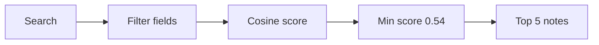

# Score threshold

|                  |                                                                           |
| ---------------- | ------------------------------------------------------------------------- |
| **Value**        | `MIN_SCORE = 0.54` in `app/search.py`, chosen by experiment               |
| **What it does** | Notes scoring below it are not returned                                   |
| **Why**          | Without it, search always returns 5 notes, even for "best pizza in Paris" |

## The problem

Cosine search always ranks **every** note, so there is always a "top 5", even when nothing fits. An off-topic question gets 5 injury notes with low scores, and they look like real results.

## The fix



- **Min score 0.54**: results below 0.54 are dropped before sorting.
- If nothing is left, search returns an empty list: "No matching notes".

## The experiment

`app/embedding/threshold.py` measures two groups of scores against the 10 test notes:

- **Good:** for each of the 12 injury questions (`eval/queries.json`), the score of the right note. These should be high.
- **Bad:** for each of the 28 off-topic questions (`eval/off_topic.json`), the best score any note gets. These should be low.

The off-topic questions come in two kinds:

- **14 easy**: nothing to do with injuries ("best pizza in Paris", "how to file my taxes").
- **14 hard**: health-related, but no note matches ("pain after eating", "toothache since yesterday").

```bash
uv run --env-file .env python -m app.embedding.threshold
```

## Results (nomic-embed-text)

| Group                         | Lowest | Highest |
| ----------------------------- | ------ | ------- |
| Injury questions (12)         | 0.55   | 0.76    |
| Easy off-topic questions (14) | 0.36   | 0.52    |
| Hard off-topic questions (14) | 0.50   | 0.62    |

**The scores overlap**: "pain after eating" (0.62) scores higher than 4 real injury questions. No threshold separates them cleanly, so we chose from the trade-off:

| Threshold | Injury questions kept | Off-topic blocked |
| --------- | --------------------- | ----------------- |
| 0.52      | 12/12                 | 20/28             |
| **0.54**  | **12/12**             | **23/28**         |
| 0.56      | 11/12                 | 23/28             |
| 0.58      | 10/12                 | 26/28             |
| 0.60      | 9/12                  | 27/28             |
| 0.62      | 8/12                  | 28/28             |

**Chose 0.54**: the highest threshold that keeps all 12 injury questions. In a health journal, missing a real note is worse than showing an extra one: you can ignore a weak match, but you never see a hidden note.

**Still let through (5):** pain after eating (0.62), my dog has a limp (0.60), toothache (0.57), burned my hand (0.57), sore throat (0.56).

## Why the hard questions score high

- The embedding model mostly captures the **topic** and the sentence shape. "pain after eating" looks like "knee pain after running": same topic (pain), same shape ("pain after X").
- A threshold only looks at one number per note. It can't tell "same topic" from "same injury".
- **Real fixes (later projects):**
  - A **reranker**: a second model reads the question and the note together and judges the real match (Project 3).
  - **Keyword + vector search**: "eating" matches no note's words, so it lowers those notes' scores.

## Rules

1. **A threshold belongs to one model.** Each model has its own score range. Change the model, rerun the experiment.
2. **Scores are not percentages.** 0.54 doesn't mean "54% relevant". It only works relative to other scores from the same model.
3. **Test with hard questions, not only easy ones.** With only easy off-topic questions, 0.54 looked perfect; the hard ones showed the overlap.
4. **When scores overlap, choose the mistake you prefer**: missing real notes (higher threshold) or showing wrong ones (lower).

## In our code

- `search(..., min_score=MIN_SCORE)` in `app/search.py`.
- `POST /search` accepts `min_score`, so you can try other values on the `/docs` page.

| Test                                        | Checks                                      |
| ------------------------------------------- | ------------------------------------------- |
| `test_min_score_drops_weak_matches`         | notes below the threshold are dropped       |
| `test_only_weak_matches_returns_nothing`    | nothing above the threshold gives `[]`      |
| `test_threshold_is_halfway...`              | the suggested value is halfway              |
| `test_overlapping_scores_give_no_threshold` | overlap gives no suggestion                 |
| `test_tradeoff_counts_kept_and_blocked`     | the table counts kept and blocked correctly |
